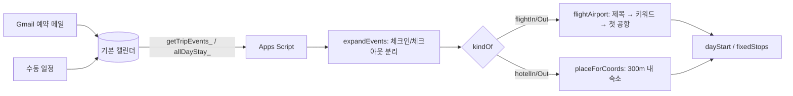

# (2026-11-09) 여행 대시보드 v2 배포 + 항공편·숙박 인식 수정

## 요약
2026 도쿄 여행 대시보드가 v1으로 배포돼 있어 clasp으로 v2.0.0을 올렸다(기존 배포 갱신, URL 유지). 실제 Google 캘린더(Gmail 자동 일정)를 직접 읽어 확인하며 항공편 공항 매칭과 Gmail 종일 숙박의 체크아웃 날짜 버그를 고쳤고, 빠져 있던 마지막 1박 숙소 일정을 캘린더에 추가했다.

## 변경 사항

### 항공편 → 공항 매칭
| 파일 | 변경 내용 |
|---|---|
| `prototype/schedule.js` | `flightAirport(ev, airports)` 추가: 제목의 해당 쪽(도착편 = 도착지, 출국편 = 출발지) 이름으로 공항을 찾고, 없으면 목적지 키워드에 맞는 공항을 쓴다. `dayStart`가 도착편 날의 출발지로 그 항공편에 연결된 공항을 우선 사용 |
| `prototype/app.js` | `loadEvents`: 항공편은 일정 위치(좌표) 대신 `flightAirport`로 장소 연결 |
| `prototype/schedule2.test.js` | 공항 매칭 / 도착 공항 출발지 테스트 2건 |

### Gmail 종일 숙박 체크아웃 날짜
| 파일 | 변경 내용 |
|---|---|
| `apps-script/Calendar.js` | `prevDay_` 추가. `allDayStay_`가 종일 일정의 마지막 날(종료일 − 1)을 체크아웃으로 본다 |
| `apps-script/server.test.mjs` | `prevDay_`, `allDayStay_` 테스트 |
| `README.md` | Gmail 일정 표: "종일 숙박은 첫날 체크인 / **마지막 날** 체크아웃" |

### 배포 (git 밖)
| 대상 | 내용 |
|---|---|
| Apps Script `1I62HBKk…6SO7m` | `clasp push -f` (v1 → v2.0.0 + 수정 사항) |
| 배포 `AKfycbyBUl…Vo` ("2026도쿄") | @1 → @2(v2.0.0) → @3(공항 매칭) → @4(체크아웃 날짜). 기존 배포를 갱신해 URL 유지 |
| `apps-script/.clasp.json` | scriptId 설정 (gitignore 대상) |
| Google 캘린더 (기본) | `그랜드 닛코 도쿄 다이바 숙박` 12/31 15:00 → 1/1 11:00 추가 |

## 결정 기록

### 새 배포 대신 기존 배포 갱신
- **상황**: 동행자에게 이미 공유한 웹 앱 URL이 있다.
- **선택지**: 새 배포 / `clasp create-deployment -i <기존 ID>`
- **결정**: 기존 배포 ID로 새 버전을 배포한다. 새 배포를 만들면 URL이 바뀐다.

### 항공편 공항은 일정 위치가 아니라 제목·키워드로 찾기
- **상황**: Gmail 항공편 일정의 위치는 출발 공항(`서울 / 김포 GMP`)이라, 도착편에 쓰면 엉뚱한 곳이 된다. 예전에는 좌표로 가까운 장소(호텔)에 연결되기도 했다. 또 도착편 날 출발지는 항상 My Maps 목록의 첫 번째 공항(김포)이었다.
- **결정**: 제목 쪽 이름으로 찾고 → 목적지 키워드에 맞는 공항 → 첫 번째 공항 순으로 고른다. 출국편 `Flight to 서울 / 김포`처럼 출발지가 제목에 없을 때는 목적지 키워드 공항(하네다)을 쓴다. 일정 탭에서 직접 연결한 장소(`eventPlace`)가 여전히 가장 우선이다.

### 종일 숙박은 마지막 날이 체크아웃
- **상황**: 실제 캘린더에서 마이하마 2박이 `12/27 ~ 종료 12/30(배타적)`, 선샤인 시티 2박이 `12/29 ~ 1/1`로 들어 있었다. Gmail은 체크아웃 날까지 칠한다.
- **결정**: 체크아웃 = 배타적 종료일 − 1일. 하루짜리 종일 일정은 숙박이 아니다.

## 문제 및 해결

### 매일 첫 일정에 "서울 / 김포 GMP · 09:00 ⚠ 숙소 일정에 장소가 연결되지 않았습니다"
- **증상**: 동선 탭 맨 위 카드가 지워지지 않는다.
- **원인**: 삭제할 수 없는 출발지 카드다. 숙소를 찾지 못하면 My Maps의 첫 번째 공항으로 대체된다.
- **해결**: 숙박 인식 수정(아래)과 캘린더 일정 보완.

### 대시보드에 `⚙ 설정 점검`이 없음
- **원인**: 배포가 v1이었다(`7225497`과 코드가 같음, 편집기에서 고친 코드 없음).
- **해결**: v2.0.0 push 및 배포 갱신. 기존 코드는 `clasp clone`으로 백업했다.

### 항공편 카드 "36:25(+1) 도착 · 46시간 늦음"
- **원인**: 목적지 키워드에 도쿄가 없어 도착편이 출국편으로 분류됐고, 일정이 호텔에 연결돼 김포 → 도쿄 호텔을 직선거리로 계산했다.
- **해결**: 설정 탭 목적지 키워드 추가 안내, 공항 매칭 수정.
- **참고**: 도착편은 동선 카드가 아니라 "출" 카드로 들어간다(설계대로). 출국편은 마지막 ✈️ 카드로 나온다.

### 선샤인 시티 프린스 호텔이 안 나옴
- **원인**: ① 종일 숙박의 체크아웃을 하루 늦게 읽어, 12/30 출발지가 마이하마로 나왔다. ② 마지막 1박(그랜드 닛코) 일정이 캘린더에 없었다.
- **해결**: `allDayStay_` 수정, 캘린더에 그랜드 닛코 일정 추가.
- **검증**: 실제 캘린더 일정 구성으로 헤드리스 재현 → 12/27 하네다, 12/29 마이하마 체크아웃 → 선샤인 체크인, 12/30 선샤인, 12/31 → 그랜드 닛코, 1/1 하네다 18:35 기한.

### clasp 로그인 / push 막힘
- `! npx @google/clasp login --no-localhost`: 입력을 받을 수 없어 프롬프트가 바로 닫혔다 → tmux 세션에서 실행하고, 리디렉션 URL을 `send-keys`로 전달.
- `clasp list`에 대시보드가 안 보임: 스프레드시트에 붙은 스크립트라서 → 스크립트 ID를 사용자에게 받음.
- "Apps Script API not enabled": 사용자 설정에서 켠 뒤 6분 이상 반영 안 됨 → 계정 확인 후 재시도에서 성공.

### 검증
- `node --test prototype/*.test.js apps-script/server.test.mjs`: 49 pass.
- `apps-script/e2e_gas.py`: 55 PASS. 스크래치 venv의 Playwright와 `~/.cache/ms-playwright/chromium-1237`을 사용했다(스크립트의 `/usr/bin/google-chrome`이 없음).

## 아키텍처

## Git 히스토리
| 커밋 | 메시지 |
|---|---|
| `b339393` | fix: match flights to airports by name; Gmail all-day stays check out on their last day |

## 다음 할 일
- [ ] 실제 대시보드에서 12/27~1/1 출발지와 귀국편 카드 확인 ("직접 설정함"이 남아 있으면 되돌리기)
- [ ] 설정 탭 목적지 키워드에 `도쿄, 하네다, Tokyo, Haneda, HND` 등이 있는지 확인
- [ ] My Maps에 하네다 공항이 있는지 확인 (없으면 공항이 김포로 잡힘)
- [ ] 그랜드 닛코 주소를 예약 확인서와 대조
- [ ] 스프레드시트 메뉴 권한(`userinfo.email`) 재승인: PC나 모바일 데스크톱 모드에서 메뉴를 처음 실행할 때
- [ ] (선택) 영어 `Check-in:` / `Check-out:` 제목 인식, 종일 예약(디즈니랜드) 처리
